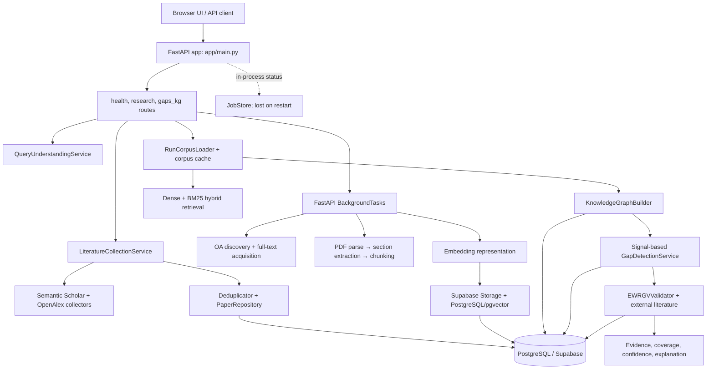

# EWRGV codebase audit

**Initial audit snapshot:** 2026-10-20. **Initial scope:** repository files under `ewrgv/`, root Git state, recent commits, and the accessible Codex histories listed below. The initial pass was documentation-only; the follow-up below records subsequent source/configuration/documentation changes and test execution.

**Follow-up update (2026-10-20):** The original audit statements above are a
baseline snapshot. A subsequent approved implementation changed retrieval
configuration and code, README/API documentation, and audit records: retrieval
API and validation callers now require CrossEncoder reranking; `/research/gaps`
uses non-LLM signal detectors and bounded reranked query/expansion context for
grounding; its LLM options reject `true`. `tests/unit/test_reranking.py` passed
(10 tests), and direct request-model validation confirmed both LLM flags reject
`true`. The combined API/signal suite did not complete: it stalled during the
first TestClient case and during a topic-clustering signal case in this Windows
Python 3.14 environment. No live external model, provider, database, or
end-to-end service was used, so this verifies code paths under tests rather
than deployment health.

## Executive summary

EWRGV is a Python 3.11+ FastAPI modular monolith for literature acquisition, evidence corpus preparation, hybrid retrieval, candidate research-gap detection, and evidence-weighted validation. At the initial audit, the README status table described the original architecture phase and placeholder routes; the README has since been updated to reflect implemented paths and current limitations. The live code has providers, Supabase/PostgreSQL persistence, S3-like Supabase object storage, background tasks tracked in process memory, an API-served vanilla JS interface, and a knowledge-graph/signal detection path.

The strongest implemented path is **query understanding → collection → separate acquisition/parse/section/chunk/representation jobs → KG build → signal-based candidate detection → validation → persisted results**. However, these are separately triggered API operations, not a durable end-to-end orchestrator. Job state is ephemeral, runtime configuration points to Supabase by default in the database pool code, and no production or configured database was inspected. Candidate generation and validation contain real logic, but evidence quality and end-to-end reliability have not been demonstrated because tests and external services did not establish that level of coverage.

**Assessment:** research MVP with meaningful backend capabilities; not yet demonstrated as a robust, restart-safe end-to-end service. UI integration exists in the current working tree, but its dependent contracts and job persistence/recovery need stabilization. The README and several older architecture documents are materially stale.

## What works in source (not a runtime claim)

- FastAPI app factory and lifespan in `app/main.py`; health, research, and KG/gap routers are mounted beneath `/api/v1`.
- Query decomposition, literature collection from Semantic Scholar/OpenAlex, deduplication and persistence.
- Full text discovery/acquisition, PDF extraction, section extraction, chunking, embedding, dense/sparse/hybrid retrieval, run-corpus loading and caching.
- Persisted graph and gap candidates; signal-based candidate generation plus a separate evidence-weighted validation workflow.
- Local UI assets under `app/ui/` are mounted at `/` if the directory exists. `app/ui/app.js` and `styles.css` are untracked in this checkout and are therefore working-tree content, not committed baseline.

## Architecture

### Runtime and module map

- **Entry/factory:** `app/main.py` exports `app = create_app()`. `create_app()` configures CORS, handlers, routers and optional static UI mount; lifespan initializes logging and a new `JobStore` on each process start. No connection-pool startup/shutdown is wired into lifespan in this file.
- **Routes:** `app/api/routes/health.py`, `research.py`, `gaps_kg.py`.
- **Core/domain:** `app/core/{config,exceptions,logging,job_store}.py`; typed records/enums under `app/domain/`.
- **Collection/ingestion:** `app/ingestion/collectors`, `deduplication`, `acquisition`, `parsers`, `sectioning`, `chunking`, `representation`, `corpus`.
- **Providers:** Semantic Scholar/OpenAlex search, OpenAI/SentenceTransformer embeddings, OpenAI/OpenRouter LLMs.
- **Persistence:** `app/storage/relational/database.py`, repositories, `supabase_storage.py`, `document_storage.py`, `storage/vector/`; SQL migrations are `scripts/migrations/01..11`.
- **Retrieval/gaps/validation:** `app/retrieval`, `app/knowledge_graph`, `app/gap_detection`, `app/validation`, `app/evidence`, `app/coverage`, `app/scoring`, `app/explanation`.
- **Execution:** route handlers schedule `BackgroundTasks`; `app/core/job_store.py` holds status dictionaries guarded by `asyncio.Lock`. This is not a separate worker system or durable queue.

## Highest-impact findings

Severity reflects user impact and operational likelihood; findings are separated from risks.

| Rank | Severity | Finding | Evidence / impact |
|---|---|---|---|
| 1 | High, confirmed design limit | Job lifecycle is process-local and non-durable. | `JobStore` is constructed in lifespan; all acquisition/processing/analysis job records live only in dictionaries. Restart loses status; multiple workers cannot share it. |
| 2 | High, confirmed contract gap | Stages are manually chained and independently triggerable; no durable pipeline coordinator enforces prerequisites. | Individual `/acquire`, `/parse`, `/sections`, `/chunks`, `/represent`, `/kg/build`, `/gaps`, `/validate` operations. UI can request stages regardless of prior completion; failures need manual recovery. |
| 3 | High, confirmed delivery gap | No evidence in this audit that the complete live pipeline succeeds against configured providers/storage/database. | Tests exist but were not run; no database/service was queried. Current backend is not integration-certified. |
| 4 | High, confirmed inconsistency risk | Database defaults and schema are Postgres/Supabase-oriented despite a SQLite-looking `DATABASE_URL` default. | `Settings.DATABASE_URL` default is SQLite, while `DatabasePool` uses `asyncpg` and migration SQL uses PostgreSQL types, pgvector, and `IF NOT EXISTS` syntax. Deployment must supply the actual Supabase DSN. |
| 5 | Resolved documentation defect | README/API docs were stale relative to implementation at the initial audit. | README and retrieval/gap API documentation now describe the live signal-based `/gaps` flow, CrossEncoder requirement, and failure behavior. Continue checking other older architecture notes for drift. |
| 6 | Medium-high, confirmed defect | Validation persistence does not check whether its UPDATE matched a detection row. | `KnowledgeGraphRepository.save_validations()` awaits `conn.execute(...)` and ignores its command tag. The worker can mark a validation job completed although no result row was updated. This matches a historic user report of candidates with null validation fields; live DB was not inspected. |
| 7 | Medium, confirmed boundary | There is no auth/authorization layer visible in app setup. | Routes can start expensive provider and DB work; CORS is not authentication. Appropriate only for trusted local deployment unless protected externally. |

## Confirmed defects vs risks

**Confirmed from source:** ephemeral jobs; manually orchestrated stages; stale docs; PostgreSQL-only migrations paired with a SQLite-looking default; validation UPDATE row-count is unchecked; in-memory corpus/cache and per-process resource assumptions; current working tree contains uncommitted API/repository/UI changes. The last point means audit statements must distinguish committed code from those edits.

**Risks, not confirmed runtime failures:** provider throttling, stale/inaccurate corpus representations, stage retries duplicating or replacing persisted outputs, query/research run association edge cases, N-worker inconsistencies, DB schema drift, incomplete validation writes, overly permissive production CORS/auth posture, and memory/time growth for large corpora. Existing retry/cache code mitigates some provider/API failures but does not make job execution durable.

## Git state and provenance

At audit start, branch was `integrate/gap-detection`, HEAD `0f7afd1` (`non LLm identification`, 2026-10-19), tracking `origin/integrate/gap-detection`. Recent history includes `0d66329 fixed rerieval and embedding issues`, `1bf2fc3 fixed parser`, `7005b45 Use PaperChunk and the run corpus for retrieval and gap detection`, and merge `109aedc`. Existing user changes were present in `ewrgv/app/api/routes/research.py`, `ewrgv/app/storage/repositories/paper_repository.py`, `ewrgv/UI-Design/README.md`, plus untracked UI JS/CSS, root ZIP, and two PDFs. They were not modified. The API inventory and behavior descriptions reflect the current working tree where noted; repository sorting and UI changes are not in HEAD.

## Conversation-history recovery and limits

Accessible Codex history included the current task, `Find project novelties`, and the local project conversation from 2026-10-19 containing detailed discussions of methodology, validation, UI behavior, and Supabase result rows. The history confirms: (1) four candidate signal families—explicit statements, sparse concept combinations, temporal staleness, sparse topics; (2) candidate grounding/ranking is distinct from validation; (3) external validation may use OpenAlex and Semantic Scholar; (4) user saw completed run selection redirect to a new pipeline and missing validation results for some runs; (5) user reported Semantic Scholar rate limiting in UI context. A recent ChatGPT thread “Refine MVP Completion” contains UI-design request but no engineering decisions.

History is a partial record, not a complete export of all past Codex/ChatGPT messages. The accessible thread list/history window is bounded; therefore the decision log below separates verified source facts from conversation-reported events. No claim is made that all project conversations were accessible.

## End-to-end conclusion

The code contains each major processing component and API trigger. It does **not** demonstrate an unattended, restart-safe, end-to-end pipeline. Tests, provider calls, migration execution, and DB inspection were intentionally not performed. See [IMPLEMENTATION_STATUS.md](IMPLEMENTATION_STATUS.md), [API_INVENTORY.md](API_INVENTORY.md), [DATABASE_AUDIT.md](DATABASE_AUDIT.md), [PIPELINE_WALKTHROUGH.md](PIPELINE_WALKTHROUGH.md), [TECHNICAL_DECISIONS.md](TECHNICAL_DECISIONS.md), and [NEXT_STEPS.md](NEXT_STEPS.md).
